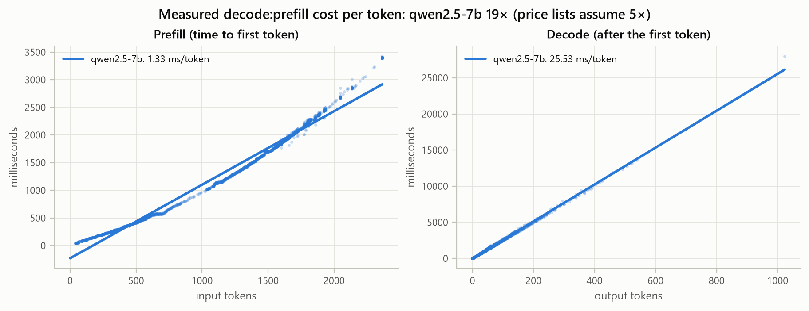
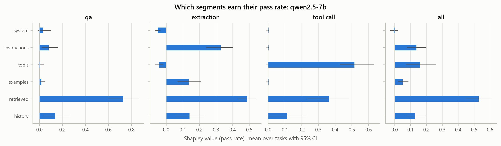
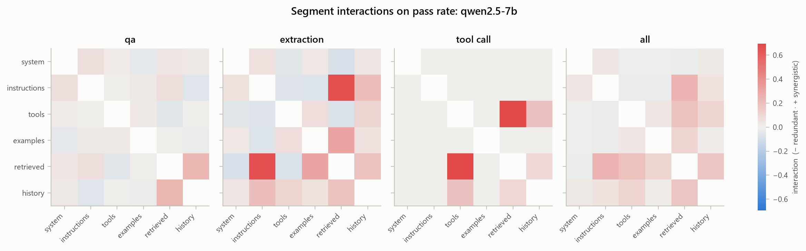
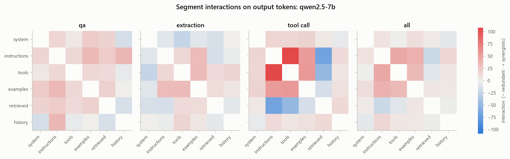
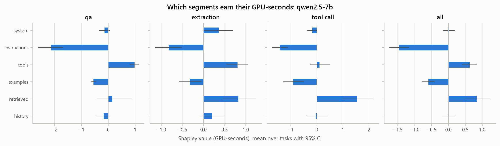
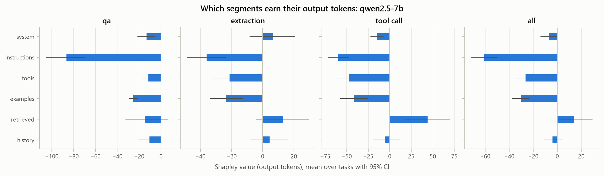
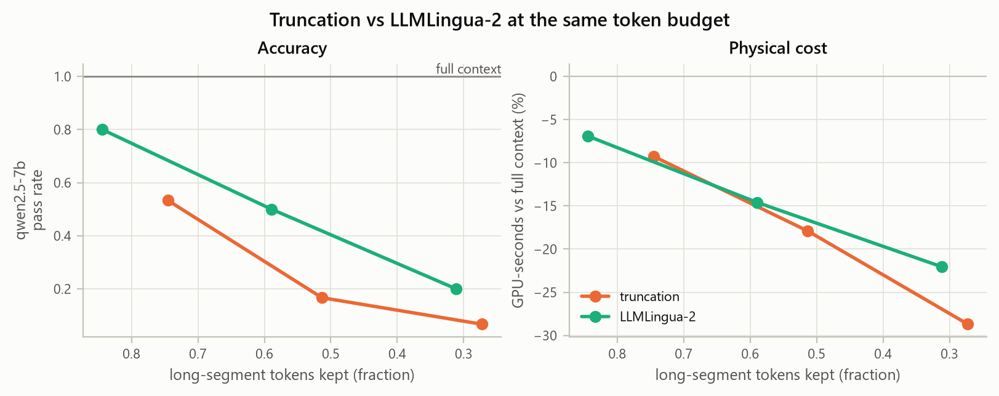
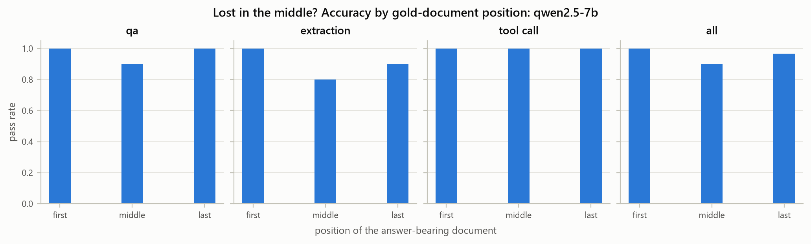
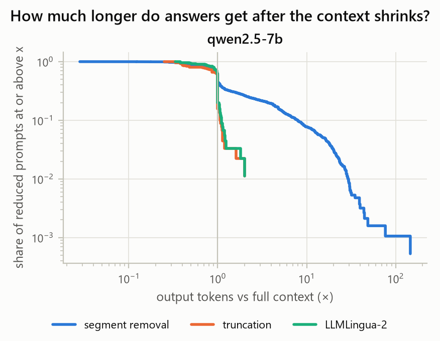
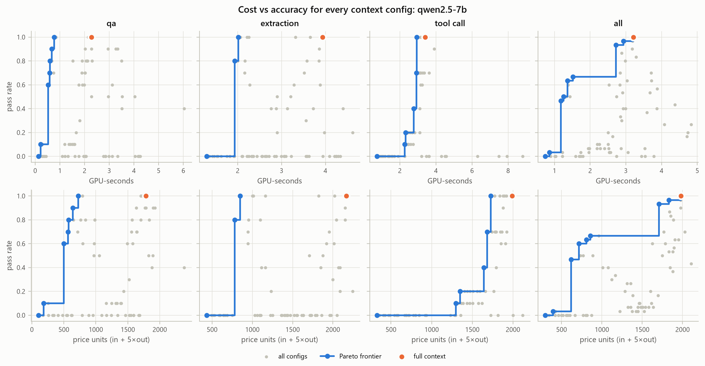

# Does Shrinking the Prompt Save Cost? Physical Measurements, Exact Token Attribution and Shapley Ablations on a T4

*Findings report. Every number in §6 traces to a file in `analysis/`, produced by `ccv analyze results/qwen2.5-7b.jsonl --out analysis/`; the figures are copies of its PNGs.*

---

## 1. Introduction

Teams shrink LLM prompts to save money: truncate retrieved documents, drop older conversation turns, strip few-shot examples, or run a learned compressor such as LLMLingua-2. The implicit model of cost is *input tokens × input price*. That model is incomplete in two ways.

1. **Output tokens dominate.** Commercial APIs bill an output token at roughly 5× an input token. On the hardware, prefill processes the whole prompt in parallel, while decode emits one token per sequential forward pass.
2. **Context changes behaviour.** A model with less context can answer at greater length, hedge, ask for clarification, or answer wrongly. Every wrong answer has a downstream cost: a retry, an escalation, or a bad decision.

We ask three questions about a 7B instruction-tuned model served on a single T4:

- **RQ1.** Which parts of a realistic prompt carry accuracy, and which carry cost, once interactions between parts are accounted for?
- **RQ2.** When context is reduced (by truncation, LLMLingua-2 compression or reordering), how often does total cost *rise* because outputs get longer?
- **RQ3.** How does the measured physical cost ratio of decode to prefill compare with the 5:1 price-list ratio?

**Contributions.** (i) `ccv`, an open-source tool that joins physical per-request GPU cost, exact per-segment token attribution and graded accuracy on the same requests. (ii) An exact 64-subset Shapley analysis of six prompt segments, with pairwise interactions. (iii) A calibrated 30-task benchmark over three workloads (QA, JSON extraction, tool calling) set in a fictional world, so answers cannot come from memory. (iv) Raw JSONL traces for every request.

---

## 2. Related work

- **Context length and accuracy.** *Lost in the Middle* (Liu et al., 2023) shows position-dependent use of long contexts. Shi et al. (2023) show that irrelevant context distracts models. Chroma's *Context Rot* (2025) reports non-uniform degradation as inputs grow. These works measure accuracy, not cost.
- **Prompt compression.** LLMLingua (Jiang et al., 2023) and LLMLingua-2 (Pan et al., 2024) compress prompts 2–5× with modest accuracy loss. They report input savings but not output-side effects on cost.
- **Attribution.** Shapley values (Shapley, 1953) and SHAP (Lundberg & Lee, 2017) attribute model outputs to inputs, usually by sampling. With six segments we enumerate all 64 coalitions exactly, and add Shapley interaction indices (Grabisch & Roubens, 1999).
- **Serving.** vLLM (Kwon et al., 2023) batches and caches prefixes for throughput. We disable both so each request's GPU time is its own (§3.1).

---

## 3. System design

### 3.1 Measurement

Each request is streamed to a vLLM 0.29 server configured with `--max-num-seqs 1` (unbatched) and prefix caching off, so a request owns the GPU and `gpu_seconds = prefill_ms + decode_ms`. Server-side per-request timings are preferred over client timings. An NVML thread samples utilisation, memory and the energy counter every 100 ms. Decoding is greedy, with `max_tokens = 1024`; capped runs are kept and reported as censored. Three warm-up requests precede each session, and runs are shuffled within each suite to spread thermal drift.

### 3.2 Exact token attribution

The prompt is split into six ablatable segments: **system** (persona), **instructions** (format and brevity rules), **tools** (8-tool catalogue), **examples** (few-shot), **retrieved** (4–6 documents) and **history** (prior turns). The query is always kept, and template overhead is counted separately. We render the served model's chat template with placeholders, map tokens to segments by character offset, and verify that the local count equals the server's `usage.prompt_tokens` (`attribution_ok`) for every request.

### 3.3 Fault tolerance

Free GPU sessions die. Each record is appended and `fsync`ed; a content-hashed `run_id` makes reruns skip finished work; `--max-minutes` stops new requests before the session limit.

---

## 4. Benchmark

**World.** All tasks are set in "Kestrel Robotics", a fictional maker of cargo drones and warehouse robots, so the query alone cannot be answered from memory.

**Workloads.** QA (short factual answers, normalised exact match that rejects hedging between candidate values), extraction (a JSON object whose fields must all match), and tool calling (the first tool call must have the right name and arguments).

**Segments.** Every task fills all six segments. The shared tool catalogue costs ~994 tokens, about half of a full prompt. That is a design choice, so `tools` carries a large *cost* share by construction, and we interpret its cost Shapley value with this in mind.

**History split.** About a third of tasks need a fact that lives only in the conversation history (the query says "our order"). The rest name their own record. This split is what lets Shapley distinguish `history` from `retrieved`.

**Quality control.** (i) A unit test checks that every grader accepts its own gold answer and rejects every listed distractor. (ii) A three-way review of all 45 drafts before any GPU time found and fixed 33 defects: cross-task contradictions, answer phrasings a correct reply would fail, queries that leaked the answer, and gold identifiers leaked through tool-catalogue examples. (iii) **Calibration:** each draft is run 3× with full context and 1× with the query only. A task is kept only if it passes 3/3 with full context and fails with the query alone. We keep 10 per workload.

**Calibration outcome.** QA 15/15, tool calling 15/15 and extraction 13/15 drafts passed; query-only failed on all 45. Extraction needed two fixes first. Tool definitions made the model call lookup tools instead of reading the documents (42/45 full-context runs), until each extraction query said where to take the answer from. The model then wrapped its JSON answers in `<tool_call>` tags, which vLLM's streaming tool parser silently dropped (33/45 runs); the runner now recovers such output with an unstreamed request. Ten tasks per workload were frozen as `benchmark-v1.0`.

---

## 5. Method

**Suites per task.** `noise`: baseline × 30. `shapley`: all 64 subsets × 1. `ablations`: truncation at 0.8/0.5/0.2 of the long segments (head of each document and of the examples, most-recent whole history turns), LLMLingua-2 at the same three rates, and the gold document moved to first/middle/last. Truncation and LLMLingua-2 share rates so they can be compared at equal budgets; plots use the *achieved* kept fraction.

**Noise floor.** From 30 identical repeats we report the identical-output rate, the pass flip rate, and the 95th percentile of repeat-to-repeat differences in output tokens and GPU time. Smaller effects are labelled within noise.

**Shapley.** v(S) is the mean metric over tasks with only segments S (plus the query) present. We report φ for pass rate, output tokens, GPU-seconds, energy and price-list cost, plus pairwise interaction indices and leave-one-out values.

**Tests.** Exact McNemar for accuracy, paired bootstrap (10,000 resamples over tasks) for cost deltas, Benjamini–Hochberg per workload.

**Cost models.** Physical: GPU-seconds and energy. Price-list: `input + 5 × output` tokens. A linear fit of prefill ms per input token and decode ms per output token gives the measured decode:prefill ratio.

---

## 6. Results

All numbers come from one Kaggle session (run K2, 30 Oct 2026). It made 3,090 requests: noise 900, Shapley 1,920 and ablations 270, using 2.36 GPU-hours and 0.155 kWh. Every request completed, and every record passed `attribution_ok`, had server-side timings and an energy reading. No `run_id` was duplicated. One run hit the 1,024-token cap (§6.8). In 417 extraction runs vLLM's streaming parser dropped the answer text; it was recovered with the unstreamed request described in §4, and no recovery failed. Each subsection names the `analysis/` file it comes from.

### 6.1 Noise floor (`noise_floor.csv`)

Each of the 30 tasks was repeated 30 times with full context. **All 900 outputs were byte-identical to their task's other repeats, and no pass/fail result ever flipped.** Timing varied very little: the coefficient of variation per task was 0.15–1.4% for prefill time and 0.4–2.3% for decode time.

Greedy decoding on an unbatched server is therefore deterministic here. Any change in output or accuracy after a context change is caused by that change. The planned extra repeats for the ablations were not needed, and only timing differences below about 2% count as noise.

### 6.2 Physical cost: decode costs 19× prefill per token (`cost_fit.csv`, `cost_per_token.png`)

| Workload | Prompt tokens | Output tokens | Prefill ms | Decode ms | GPU-s | Energy (J) | Decode share of GPU time | Output share of price-list cost |
|---|---|---|---|---|---|---|---|---|
| QA | 1,751 | 6.2 | 2,142 | 141 | 2.28 | 148 | 6% | 2% |
| Extraction | 1,870 | 59.4 | 2,350 | 1,581 | 3.93 | 257 | 40% | 14% |
| Tool calling | 1,745 | 49.0 | 2,112 | 1,293 | 3.41 | 223 | 38% | 12% |
| **All** | | | | | **3.21** | **209** | **28%** | **9%** |

*Full-context baseline (noise suite, means; GPU utilisation 99.8%).*

A linear fit over all 3,090 runs gives:

- **Prefill:** 1.33 ms per input token (R² = 0.983).
- **Decode:** 25.5 ms per output token (R² = 0.998).

The **measured decode:prefill cost ratio is therefore 19.2:1, almost four times the 5:1 price-list ratio (RQ3).** On this hardware, output is 28% of the GPU time for a full prompt, while the price-list model counts it as only 9% of the cost.

Prefill is not quite linear. Its fit has a negative intercept (−229 ms), and the points curve upwards (the figure), because the per-token cost of attention grows with prompt length when Turing-generation GPUs lack FlashAttention. Fitted separately by prompt length, the prefill slope is:

| Prompt length (tokens) | Prefill ms per token |
|---|---|
| Below 600 | 0.84 |
| 600–1,200 | 1.21 |
| 1,200–1,800 | 1.63 |
| 1,800–2,400 | 2.03 |

The marginal decode:prefill ratio therefore runs from about 30:1 for short prompts to about 12:1 for long ones.

At these lengths one output token costs as much as about 19 input tokens. Cutting 1,000 input tokens saves about 1.3 s, and 52 extra output tokens are enough to cancel that saving.

### 6.3 Which segments carry accuracy (`shapley.csv`, `shapley_passed.png`)

| Segment | Shapley φ (all) | 95% CI | Leave-one-out | QA | Extraction | Tool calling |
|---|---|---|---|---|---|---|
| retrieved | **0.528** | 0.446 – 0.609 | 0.900 | 0.730 | 0.488 | 0.365 |
| tools | 0.160 | 0.070 – 0.260 | 0.333 | 0.007 | −0.042 | **0.515** |
| instructions | 0.137 | 0.077 – 0.199 | 0.300 | 0.080 | **0.328** | 0.002 |
| history | 0.131 | 0.073 – 0.194 | 0.367 | 0.137 | 0.140 | 0.115 |
| examples | 0.051 | 0.021 – 0.087 | 0.133 | 0.017 | 0.135 | 0.002 |
| system | −0.006 | −0.027 – 0.023 | 0.033 | 0.030 | −0.050 | 0.002 |

*φ for pass rate; values sum to v(all) − v(none) = 1 − 0, as the efficiency axiom requires.*

The retrieved documents carry half of all accuracy. After that, each workload depends on the segment that tells it *what to produce*:

- Tool calling depends on the tool catalogue.
- Extraction depends on the instructions, which list the JSON fields.

The system persona contributes nothing measurable.

Leave-one-out values sum to 2.07, about twice the total there is to share. They count every synergy once per partner (§6.4), which is why we report Shapley values.

Removing only the history fails 11 of 30 tasks (37%), close to the intended third (§4).

### 6.4 Interactions (`interactions.csv`, heatmaps)

The strongest accuracy interactions are synergies between the documents and the segment that turns them into an answer:

| Workload | Pair | Interaction | Meaning |
|---|---|---|---|
| Tool calling | tools × retrieved | +0.70 | The model needs the tools and the facts to fill their arguments |
| Extraction | instructions × retrieved | +0.66 | The model needs the field list and the documents |
| QA | retrieved × history | +0.24 | The model needs the documents and the history that names the record |

Each such segment is worth little on its own, so neither leave-one-out nor input-token share can rank them.

For output length, instructions, tools and examples interact positively (all workloads: instructions × tools +46 tokens, instructions × examples +40). This means they are **substitutes**: any one of them is enough to keep answers short. Output grows only when all of them are gone.

### 6.5 Which segments carry cost (`shapley.csv`, `shapley_gpu_seconds.png`, `shapley_decode_tokens.png`)

| Segment | Prompt tokens | φ output tokens | φ GPU-seconds | φ energy (J) | φ price-list units |
|---|---|---|---|---|---|
| tools | 993 | −26.5 | +0.63 | +38.5 | **+861** |
| retrieved | 352 | +14.0 | **+0.84** | +54.9 | +423 |
| system | 143 | −7.0 | +0.02 | +0.7 | +107 |
| history | 68 | −3.9 | −0.01 | −0.5 | +48 |
| examples | 119 | −30.3 | −0.59 | −39.4 | −33 |
| instructions | 61 | **−60.9** | **−1.46** | **−97.1** | −243 |

*All workloads; the baseline is 3.21 GPU-s and 1,980 price units.*

The physical and price-list models disagree on which segment is most expensive:

- **Price list:** the tool catalogue is the most expensive segment, at 43% of the cost, because it is half the prompt.
- **Physical cost:** the retrieved documents cost more GPU time than the catalogue. The catalogue shortens the output by 26 tokens, which buys back most of its prefill, while the documents lengthen it.

**Instructions and examples have negative cost.** Their few tokens shorten every answer by enough to pay for themselves several times over. Removing the 61-token instructions segment *adds* 1.46 GPU-seconds on average, almost half a full request.

**Leave-one-out misreads cost.** It probes only prompts one segment away from the full prompt, but output grows only once several segments are gone:

- Leave-one-out says dropping the tool catalogue saves 1.65 GPU-seconds; its Shapley value is 0.63.
- In tool calling, leave-one-out says the instructions *cost* 0.16 s, while their Shapley value shows they *save* 1.42 s.

The φ values sum to v(all) − v(none) = −0.58 s: the query alone is *more* expensive than the full prompt (§6.8).

### 6.6 Truncation versus LLMLingua-2 at equal budget (`comparisons.csv`, `truncation_vs_llmlingua2.png`)

| Method, nominal rate | Long-segment tokens kept | Accuracy | McNemar q | GPU-seconds vs full | Price-list cost vs full |
|---|---|---|---|---|---|
| Truncation 0.8 | 0.75 | 0.53 | 0.0002 | −9.3% | −7.5% |
| Truncation 0.5 | 0.51 | 0.17 | < 0.001 | −17.9% | −14.3% |
| Truncation 0.2 | 0.27 | 0.07 | < 0.001 | −28.7% | −22.2% |
| LLMLingua-2 0.8 | 0.85 | 0.80 | 0.035 | −6.9% | −4.8% |
| LLMLingua-2 0.5 | 0.59 | 0.50 | < 0.001 | −14.6% | −11.7% |
| LLMLingua-2 0.2 | 0.31 | 0.20 | < 0.001 | −22.1% | −19.0% |

*Baseline accuracy is 1.0 by calibration; the kept fractions are medians of the achieved values.*

**Every reduction lost a statistically significant amount of accuracy, even when it kept 75–85% of the long text.** At each budget, LLMLingua-2 kept more accuracy than truncation, and the two saved about the same GPU time per token removed. Neither method made outputs longer (§6.8).

**Why truncation is so harsh here.** Truncation drops whole user/assistant turns from the history, oldest first, as a chat window does. Twenty-six of the 30 tasks have a single exchange of history, so "keep 80%" removed *all* of it. Eleven of the 14 tasks that fail at truncation 0.8 are exactly the tasks that fail whenever the history is removed. Their oldest turn holds the order number or serial the query refers to.

**What compression costs.** On the same T4, LLMLingua-2 took a median of **0.88 s per task** to compress. The GPU time it then saved was:

- 0.14 s at rate 0.8;
- 0.38 s at rate 0.5;
- 0.59 s at rate 0.2.

If compression runs once per request, total GPU time *rises* for 90–97% of tasks. The saving only materialises if compressed documents are cached and reused across many queries.

**A failure mode.** Two compressed extraction tasks failed by calling `lookup_order` instead of answering from the documents. This is the same tool hijacking seen during calibration (§4), and it returned once the documents became harder to read.

### 6.7 Lost in the middle (`reorder_position.png`)

| Gold document position | First | Middle | Last |
|---|---|---|---|
| Pass rate | 1.00 | 0.90 | 0.97 |

The middle position is the lowest, matching Liu et al., but the drop is three tasks out of 30 and is **not significant** (McNemar q = 0.26). With 4–6 documents of about 2k tokens in total, position matters little for this model.

### 6.8 Output expansion and when reduction raised cost (`expansion.csv`, `expansion_ccdf.png`)

Removing whole segments is a different matter from truncation or compression. Each cell below is one task under one reduced configuration, compared with the same task at full context:

| Reduction | Cells | Output > 1.5× | Output > 2× | p90 ratio | Max ratio | GPU-seconds rose | Price-list cost rose |
|---|---|---|---|---|---|---|---|
| Segment removal (63 subsets) | 1,890 | 30.4% | 26.3% | 7.9× | 146× | **19.0%** | 6.1% |
| Truncation | 90 | 2.2% | 0% | 1.06× | 2× | 1.1% | 0% |
| LLMLingua-2 | 90 | 2.2% | 0% | 1.09× | 2× | 1.1% | 0% |

**In 19% of segment-removal cells, the shorter prompt used *more* GPU time than the full prompt (RQ2).** The price-list model sees only a third of these cases, because it underweights output (§6.2).

Almost all of the cost increases are explained by one segment: **98.6% of the cells where GPU time rose had no instructions segment**, against 51% of all cells. The increases also come with failure: 295 of the 359 such cells also failed the task, so the model paid more to be wrong.

| Workload | Instructions removed: output > 2× | Instructions removed: cost above full prompt | Instructions kept: cost above full prompt |
|---|---|---|---|
| QA | 99.7% | 60% | 0% |
| Extraction | 23% | 23% | 0% |
| Tool calling | 30% | 27% | 1.6% |

When the instructions are missing, keeping the few-shot examples roughly halves the damage: cost rises above the full prompt in 27% of such cells, against 47% without examples.

**The smallest prompt is not the cheapest.** The query alone fails every task, yet it costs 18% more GPU time than the full prompt:

| Workload | Query alone vs full prompt |
|---|---|
| QA | +83% |
| Tool calling | +26% |
| Extraction | −27% |

QA is the most exposed workload, with cost rising in 31% of its cells, because its full-context answers are so short (about 6 tokens). Some examples:

- **QA without instructions** (`subset:101111`): 90% accurate, but 40 more output tokens, +43% GPU time and +8% price-list cost.
- **Query alone:** median output length is 164 tokens for QA, 172 for tool calling and 93 for extraction. With full context the medians are 6, 49 and 60.
- **The single capped run** (qa-10 without instructions or history): 1,024 tokens of repeated `lookup_flight_envelope` calls, taking 26 s of decode time, as much as eight normal requests.

### 6.9 Pareto frontiers (`pareto.csv`, `pareto_qwen2.5-7b.png`)

The cheapest configuration that still passed every task:

| Workload | Segments kept | GPU-s | vs full context |
|---|---|---|---|
| QA | system, instructions, retrieved, history | 0.77 | **−66%** |
| Extraction | instructions, retrieved, history | 2.01 | **−49%** |
| Tool calling | instructions, tools, retrieved, history | 2.94 | −14% |
| All (one prompt) | instructions, tools, retrieved, history | 2.72 | −15% (accuracy 0.93) |

The savings come from dropping segments the workload does not use, chiefly the tool catalogue for QA and extraction, and from dropping the examples. They do not come from cutting content.

**Held-out check (`analysis/heldout/`).** These configurations were chosen in-sample, from 64 options on the same 10 tasks per workload, so their accuracy is optimistic by construction. We therefore re-ran them, with the full prompt as baseline, on the 15 drafts that were written to the same rules but never used for selection (run K3, 60 requests). The primary set is the 13 drafts that passed calibration; ex-02 and ex-06 failed it.

| Workload | Configuration | Held-out tasks | Accuracy (full prompt) | GPU-s vs full context (held-out) | In-sample |
|---|---|---|---|---|---|
| QA | system, instructions, retrieved, history | 5 | 5/5 (5/5) | **−70%** | −66% |
| Extraction | instructions, retrieved, history | 3 | 2/3 (3/3) | **−48%** | −49% |
| Tool calling | instructions, tools, retrieved, history | 5 | 4/5 (5/5) | −17% | −14% |
| All (one prompt) | instructions, tools, retrieved, history | 13 | 12/13 = 0.92 (13/13) | −17% | −15%, accuracy 0.93 |

- **The cost savings replicate.** On new tasks, each configuration saved within 4 percentage points of its in-sample saving.
- **Accuracy mostly holds.** The single shared prompt scored 0.92 held-out against 0.93 in-sample. QA lost nothing. With one discordant task per workload, no difference is significant (McNemar p = 1).
- **Both failures come from dropping the examples.** The few-shot examples turn out to carry field meanings that no other segment states:
  - ex-03 put the booking ID into `serial_number` and the serial into `model`. The examples are where `model` is shown to be a product name.
  - tc-04 emailed the invoice to `finance@skycart.in`, an address the model invented from "our finance team". The documents give `accounts@skycart.in`.
- **Removing the tool catalogue rescued tasks it had broken.** ex-02 and ex-06 fail with the full prompt because the model calls a lookup tool instead of answering (§4). Both pass under every configuration without tools.

The rule "drop what the workload does not use" therefore generalises; "drop the examples" is riskier than in-sample selection suggested.

The price-list frontier (bottom row of the figure) has the same shape, but it ranks configurations with long outputs as cheaper than they are physically.

---

## 7. Deployment recommendations

1. **Measure output, not just input.** A decode token cost 19× a prefill token on this setup, against 5× on price lists. A change that removes input tokens but adds output tokens can raise both cost and latency, and input-token counters will not show it.
2. **Never strip format and brevity instructions to save tokens.** Instructions are the only segment with clearly negative cost: removing them added 1.46 GPU-seconds per request and lay behind almost every case where a shorter prompt cost more. Few-shot examples behave similarly, to a lesser degree.
3. **Remove what the workload does not use before compressing what it does.** Dropping the tool catalogue from QA and extraction prompts saved 48–70% of GPU time, in-sample and on held-out tasks. Truncation and compression saved at most 29%, and lost accuracy at every rate. Keep the few-shot examples when they define what each output field means: dropping them caused both held-out failures.
4. **Do not window chat history by whole turns.** The oldest turn often holds the identifiers the conversation is about. Pin those facts, or summarise old turns, rather than drop them.
5. **If compressing, prefer LLMLingua-2 over head truncation, and cache the result.** It kept more accuracy at every budget. Run per request on the same GPU, however, its own cost exceeded the saving.
6. **Gate every context change on accuracy with a paired test.** Even 80–85% retention lost significant accuracy. Greedy decoding is deterministic here (§6.1), so one paired run per task is enough to detect a change.
7. **Track the output-length tail, not the mean.** Report the p90 output ratio and the capped share. One runaway tool-call loop cost as much as eight normal requests.
8. **Test the serving stack's parsers.** vLLM's streaming hermes parser silently dropped 417 answers in this sweep alone and labelled a capped run as a finished tool call. Both would have corrupted accuracy and cost figures without the checks in `ccv`.

---

## 8. Limitations

- **One model, one GPU.** Qwen2.5-7B-Instruct (AWQ 4-bit) on a T4 with fp16 and Triton attention. Llama-3.1-8B is supported but was not swept, for schedule reasons. AWQ kernels and Turing hardware shape the prefill:decode ratio.
- **Unbatched serving.** Batching amortises decode across requests in production, so absolute GPU-seconds here overstate per-request production cost. The measured trade-offs are about relative changes.
- **30 tasks.** Small samples limit power. We report effect sizes with confidence intervals and correct for multiplicity rather than claim small effects.
- **Greedy decoding.** It isolates context effects, but sampling-based deployments would show more variance.
- **Synthetic world.** The fictional world prevents memorisation but is cleaner than real enterprise data, and the shared tool catalogue fixes the share of tokens spent on tools.
- **Calibration selection.** Keeping only tasks the model gets right with full context makes the baseline accuracy 100% by design. Results describe the loss from removing context, not absolute capability.
- **Coarse history truncation.** Truncation drops whole turns, so with a single exchange of history any rate below 1.0 removes all of it. This mirrors common chat windowing, but it makes truncation look worse than token-level history truncation would.
- **Small held-out check.** The cheapest configurations in §6.9 were picked in-sample. They were re-tested on only 13 held-out tasks (3–5 per workload): enough to show the savings replicate and to expose the examples failure, too few to bound held-out accuracy tightly.
- **Compression timing.** LLMLingua-2 compression was timed once per text, in the session that built the cache, rather than inside the measured requests.

---

## 9. Conclusion

Shrinking a prompt does not reliably shrink its cost. We combined physical GPU measurements, exact token attribution and an exact 64-subset Shapley analysis on a 7B model served on a T4. The results:

- **Per-token cost:** a decode token cost 19 times a prefill token, nearly four times the price-list ratio.
- **Segment removal:** in one case in five, removing a prompt segment made the request *more* expensive, almost always because the instructions that keep answers short were gone.
- **Content reduction:** truncation and LLMLingua-2 rarely lengthened outputs, but both lost significant accuracy even when they kept most of the text. Turn-based history windowing was particularly damaging.
- **Segment value:** Shapley values separated the segments that carry accuracy (documents, tools, instructions, history) from those that carry only cost. They also showed that the two cost models disagree about which segment is most expensive.

The practical rule is to remove what a workload does not use, keep the instructions, and test every context change on accuracy and on physical cost before shipping it. `ccv` does exactly that, and its raw traces make every number here reproducible.

---

## References

See the formal report, Chapter 10.
